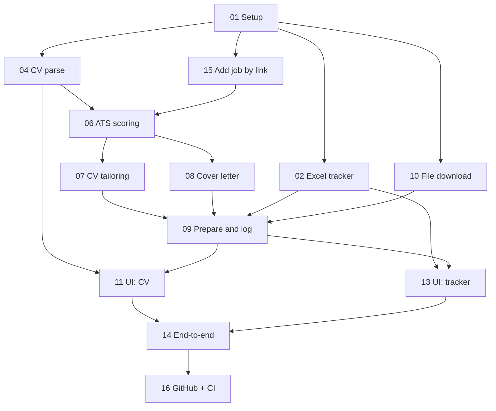

# Kanban board

Columns: Backlog -> In Progress -> Review (waiting for your feedback) -> Done
A card is Done only when its acceptance criteria in `.github/issues/` pass and you approve it.

| Backlog | In Progress | Review (your feedback) | Done |
|---|---|---|---|
| 14 End-to-end run with real CV | 13 Frontend: tracker (browser pass once an application is logged) | 01 Project setup | |
| 16 Push to GitHub + CI | | 02 Excel tracker | |
| | | 04 CV upload and parsing | |
| | | 06 ATS scoring | |
| | | 07 CV tailoring + honesty guard | |
| | | 08 Cover letter | |
| | | 09 Prepare and log | |
| | | 10 Secure file download | |
| | | 11 Frontend: CV | |
| | | 15 Add job by link (backend done, 422 paste form checked in browser) | |

Backend: 167 tests pass offline (LLM and HTTP faked). Frontend: `tsc` and `vite build` pass. Updated 2026-10-16.

Review means the code is written and tested and is waiting for you. Reply `approve` or `change: <what>` per card.

NatWest Data Scientist (Economic Crime Hub) is the first real run: CV, ATS score and cover letter are in `data/output/m_51032e2d7a668fb8/`.

Retired: cards 03 (search profiles), 05 (job search across 7 APIs) and 12 (search results UI) were dropped. Job-board APIs gave poor matches for the roles targeted and cost money; scraping LinkedIn/Indeed breaks their terms. Pasting a job link (card 15) replaced all of it.

## Dependencies

Build order is parallel because every module codes against `models.py`. These are the runtime and integration dependencies.

## How the app runs

1. Backend: `backend\.venv\Scripts\python.exe -m uvicorn app.main:app --port 8000` (API at http://localhost:8000/api).
2. Frontend: `npm run dev` in `frontend` (UI at http://localhost:5173, proxies /api to the backend). Tabs: My CV, Add a job, Applications.
3. Data lives in `data/`: your CV, generated files, and `tracker.xlsx`. The whole folder is git-ignored.
4. AI steps use your Claude login through VS Code, so no API key is needed. `backend/.env` only holds `LLM_BACKEND`, `CLAUDE_MODEL` and optionally `ANTHROPIC_API_KEY` if you switch to the API. No job-board keys are used any more.

## How feedback is collected

Two loops: one for building the app, one for using it.

**Build loop (per card)**
1. A card reaches Review when its tests and acceptance criteria pass.
2. I post a short demo note: what changed, what to try, known gaps.
3. You reply `approve`, or `change: <what>`.
4. `change` creates a follow-up card at the top of In Progress, linked to the original. Approved cards go to Done.
5. Feedback is logged in `feedback/<card>.md` (date, your comment, decision), so nothing is lost between sessions.

**Use loop (inside the app)**
- Each tailored CV and cover letter gets a thumbs up/down and an optional comment.
- Ratings go to a `Feedback` sheet in `tracker.xlsx`, next to the application row.
- Tailoring and cover-letter prompts are reviewed against this sheet, so you can see which jobs produced weak output.
- The `Status` column (Interview, Rejected, ...) is the long-term outcome feedback: we compare ATS score with real results to check whether the score predicts anything.
